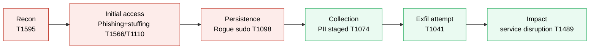

# Sable Finch — Incident Case File (Episode 32 capstone) — WORKED EXAMPLE

> A model to show the standard and depth. Yours will cite your own evidence files and
> timestamps — copy the **structure and rigour**, not the specifics.

**Analyst:** A. Analyst · **Incident ID:** NG-IR-SABLEFINCH · **Classification:** Internal · **Date:** 2026-11-02

## 0. Executive brief
- **What happened:** An external group ("Sable Finch") phished our CFO, used stolen and
  guessed credentials to reach a forgotten billing server, created a hidden admin account,
  and staged customer data for theft. We detected it, cut off access, removed their foothold,
  and restored the wallet service safely.
- **Business impact:** ~3 hours of heightened risk to customer PII on one legacy host; the
  wallet service was taken offline for 48 minutes during containment. No confirmed customer
  loss; staged data was removed before a successful pull.
- **Status:** Contained, eradicated, recovered.
- **Residual risk:** The legacy billing host should not exist; until it's decommissioned the
  same path is reachable.
- **The one ask:** Approve decommissioning `legacy-billing` and fund MFA on all admin logins
  (budget + a 2-week change window).

## 1. Summary & scope
Covers NovaGrid's wallet and billing environment, 2026-10-29 to 2026-10-30. T0 is the first
confirmed malicious event: the CFO phishing click on 2026-10-29 16:41.

## 2. Master timeline (extract)
| Time | Event | Host | Evidence ref |
|---|---|---|---|
| T0 = 10-29 16:41 | CFO clicks phishing link; credentials entered on look-alike portal | n/a | ep11/evidence/headers.png |
| 10-30 00:41 | 32 failed admin logins then success from 203.0.113.66 | legacy-billing | ep31 ALRT-1022 |
| 10-30 00:52 | Rogue `support-svc` account added to sudo | legacy-billing | ep31 ALRT-1038 |
| 10-30 01:10 | customers.csv copied into public web dir | legacy-billing | ep31 ALRT-1062 |
| 10-30 08:14 | Alert triaged, incident declared | SOC | ep31 shift report |
| 10-30 08:40 | Service isolated, account disabled | legacy-billing | ep21/evidence |
| 10-30 09:28 | Wallet service restored after re-scan | wallet-api | ep22/evidence |

## 3. Kill chain (MITRE ATT&CK) — extract
| Stage | What they did | Evidence | Technique | Control / gap | Mitigation |
|---|---|---|---|---|---|
| Initial access | Phishing + credential stuffing | ep11, ep18 | T1566, T1110 | GAP: no MFA on the portal | M1032 MFA |
| Persistence | Rogue sudo account | ep31 ALRT-1038 | T1098 | GAP: no alert on sudo-group change w/o ticket | M1047 Audit |
| Collection | PII staged in web root | ep31 ALRT-1062 | T1074 | Caught by data-staging alert | M1057 Data loss prevention |

**Earliest realistic stop point:** Initial access — MFA on admin logins (M1032) would have
broken both the phished and the stuffed credentials and ended the campaign before it started.
That's the headline of the exec brief.

## 4. Detection & analysis
Found during the Episode 31 shift: four alerts on `legacy-billing` sharing IP 203.0.113.66
correlated into one intrusion (brute force → valid account → persistence → staging). Triage
confirmed an active incident, not isolated events.

## 5. Containment & eradication
Isolated legacy-billing from the wallet subnet, disabled `support-svc`, revoked the leaver's
SSH key, removed the staged customers.csv (hashed first for evidence). Verified no other
unauthorised accounts or scheduled tasks remained (ep21).

## 6. Recovery
Re-scanned the wallet host (clean), confirmed patches and monitoring, restored service from a
known-good state, and ran a restore test on the backup (ep22). Go-live gate: clean scan +
monitoring on + change approval.

## 7. Lessons learned & remediation
| Gap | Risk | Action | Owner | Due |
|---|---|---|---|---|
| No MFA on admin logins | High | Enforce TOTP on all admin SSH/portal | Tunde | 2026-11-16 |
| legacy-billing unmanaged | High | Decommission; migrate any live function | Tunde | 2026-11-30 |
| No alert on sudo change w/o ticket | Medium | Add detection correlating sudo changes to the change calendar | Amara | 2026-11-09 |

## 8. Kill-chain diagram

Red = a control gap let them through; green = a control caught or blocked them.

## 9. NIST CSF mapping
IDENTIFY (§1 scope, asset gap) · PROTECT (§7 MFA/decommission actions) · DETECT (§4) ·
RESPOND (§5) · RECOVER (§6). All five functions exercised.
